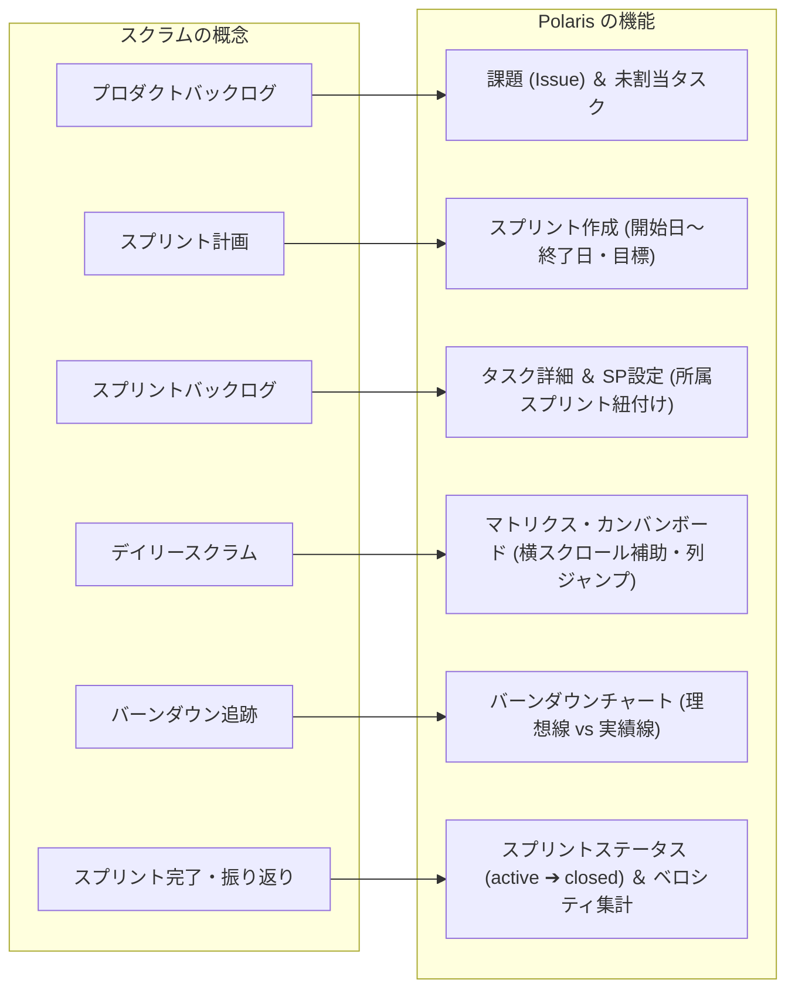
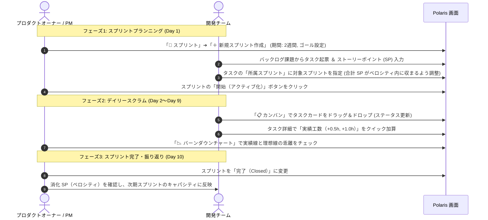

# Polaris スクラム実践スタートガイド (Scrum Starter Guide)

本書は、Polaris のアジャイル機能（スプリント、ストーリーポイント、カンバン、バーンダウンチャート）と、確立された品質保証原則（`docs/testing_lessons_and_guidelines.md`）を活用して、**チームが最短で高品質なスクラム開発を立ち上げ・運用するための実践的ガイドブック**です。

---

## 1. はじめに: なぜ Polaris でスクラムを行うのか？

多くのプロジェクト管理ツールでは、「アジャイルのベロシティ管理（ストーリーポイント）」と「従来の進捗・工数管理（時間・ガントチャート）」が分断されがちです。

Polaris は、この2つを高い次元で統合した**ハイブリッド・プロジェクト管理システム**です：
- **相対規模（ストーリーポイント）**: スプリント計画、チームキャパシティ、バーンダウン分析に使用
- **絶対時間（予定・実績工数）**: 日々の工数集計、予実差異分析、ガントチャート連動に使用
- **ビルトイン品質保証**: 不具合の事後分析（Post-Mortem）に基づく受入チェックリストと直結し、技術的負債を溜めないスプリント運用を実現

---

## 2. スクラム概念 × Polaris 機能対応マップ

スクラムの標準的な枠組みと、Polaris の画面・機能は以下のように直感的に対応しています：

| スクラム概念 | Polaris での対応機能 | 画面上の場所 | 主な役割 |
| :--- | :--- | :--- | :--- |
| **プロダクトバックログ** | 課題一覧 / 未割当タスク | 「📋 カンバン」または「🏃 スプリント」の未割当リスト | 将来実装すべき要求やフィーチャーのストック |
| **スプリント** | スプリントエンティティ | 「🏃 スプリント」タブ ➔「＋ スプリント作成」 | 1〜2週間のタイムボックス（開始日・終了日・ゴール） |
| **ストーリーポイント** | タスクの SP 属性 | タスク詳細「🏃 スプリント ＆ ストーリーポイント設定」 | 作業の相対規模・難易度・不確実性の見積もり値 |
| **スプリントバックログ** | スプリント所属タスク | 「🏃 スプリント」内の各スプリントカード | 今スプリントで「Done」にコミットする作業項目群 |
| **デイリースクラム** | カンバンボード | 「📋 カンバン」タブ | 課題スイムレーン × ステータス列での日々の状況共有 |
| **スプリント進捗追跡** | バーンダウンチャート | 「🏃 スプリント」➔「📉 バーンダウン」タブ | 理想線と実績線の乖離から遅延リスクを早期検知 |
| **ベロシティ (Velocity)** | 消化 SP 集計 | スプリントヘッダーの「⚡ 合計 XX SP」バッジ | チームが1スプリントで安定して消化できるポイント量 |

---

## 3. ストーリーポイント（SP）相対見積もり実践ルール

### 3.1 時間（工数）とストーリーポイントの明確な使い分け
- **ストーリーポイント (SP)**: 「タスクの規模・複雑さ・未知のリスク」。担当者の経験値（シニア/ジュニア）に依存しない不変のボリューム。
- **工数（時間）**: 「特定の実装者がそのタスクを完了するのにかかる時間」。

### 3.2 フィボナッチ数列による見積もり基準表

チーム全員で見積もりのブレをなくすため、以下の基準表を合意・運用します：

| ポイント | 規模の目安 | 具体例（Web/API開発） | 判断基準 |
| :---: | :--- | :--- | :--- |
| **1 pt** | 極めて単純・自明 | 文言変更、環境変数追加、定数定義、Typo修正 | 調査不要、30分〜1時間程度で完了 |
| **2 pt** | 軽微な改修 | 既存画面への項目追加、単純なバリデーション追加 | 実装パターンが確立されており迷いがない |
| **3 pt** | **【チーム基準】標準タスク** | 単一テーブルのCRUD API、標準的な新規Vueコンポーネント | 設計が自明で、単体テストを含めて無理なく完了できる |
| **5 pt** | やや複雑・少し調査が必要 | 複数テーブルの集計処理、外部API連携、認証認可ロジック | 考慮すべきエッジケースやデータ不整合リスクが存在 |
| **8 pt** | 重いタスク・1スプリントの上限 | 画面全体のゼロベース構築、複雑なステート管理・WebSocket | 1人のメンバーが数日間集中する必要がある |
| **13 pt〜** | **大きすぎるタスク（分割必須）** | 「○○機能の全面刷新」「決済基盤の統合」など | **そのままスプリントに入れてはならない**。親課題（Issue）とし、複数の 2〜5pt タスクに分解する |

> 💡 **基準タスクの決定**:
> 初めてスクラムを導入する場合、過去にチームで実装した「標準的なタスク」を1つ選び、**「これを 3 pt の基準としよう」**とチーム全員で合意することから始めてください。

---

## 4. スプリントのライフサイクル ＆ Polaris 操作手順（ステップ・バイ・ステップ）

一般的な **2週間スプリント（10営業日）** の運用フローに沿って解説します。

### ステップ1: スプリントの作成（プランニング）
1. プロジェクトワークスペース上部の「🏃 スプリント」タブを開きます。
2. **「＋ 新規スプリント作成」**をクリックします。
   - **スプリント名**: `Sprint 1`
   - **スプリントゴール**: `コア機能MVPの完成と認証フローの動作確認`
   - **開始日・終了日**: カレンダーから開始日と終了日（2週間後）を選択します（PR #22 で保存・永続化が完全保証されています）。
3. 「スプリントを作成」をクリックして保存します。

### ステップ2: タスクの見積もりと割り当て
1. 課題（Issue）から子タスクを作成するか、既存タスクの詳細画面を開きます。
2. **「🏃 スプリント ＆ ストーリーポイント設定」**エリアを開きます：
   - **ストーリーポイント (SP)**: 相対見積もり値（例: `3`, `5`）を入力。
   - **所属スプリント**: 先ほど作成したスプリントを選択。
3. **「変更を保存」**をクリックします（PR #23 により、スプリント紐付けとポイントが確実に永続化されます）。
4. スプリント画面上部に表示される「合計 XX SP」を確認し、チームのキャパシティ（目安: 20〜30 SP）を超えていないか確認します。
5. 準備が整ったら、スプリントヘッダーの**「⚡ スプリントを開始」**をクリックしてステータスを `active` に切り替えます。

### ステップ3: デイリースクラムとカンバンボードの運用
1. 毎朝のデイリースクラムでは「📋 カンバン」タブを開きます。
2. **横スクロール補助機能の活用**（PR #21）:
   - 列数が多い場合は、上部に固定表示されるスリムな**上部連動スクロールバー**で素早く横移動。
   - ツールバーの**「◀」「▶」ボタン**で1列ずつ軽快にスクロール。
   - **「📍 列へ移動...」**セレクトボックスから、目的のステータス列（例:「レビュー中」）へ一発ジャンプ。
3. 担当者は作業着手時にカードを「進行中」へドラッグし、完了時に「完了」へドラッグします。
4. タスク詳細で、日々の「実績工数（+0.5h, +1.0h, +2.0h チップ）」を記録します。

### ステップ4: バーンダウンチャートでの遅延検知
1. スプリント画面の「📉 バーンダウン」タブを開きます。
2. **理想線（青い点線）**と**実績線（緑の実線）**を比較します：
   - 実績線が理想線より**下**: 予定より早く消化が進んでいる（順調）。
   - 実績線が理想線より**上**: タスクの消化が遅れている（遅延リスクあり）。
3. 乖離が大きい場合は、スプリント終了を待たずに「優先度の低いタスクをバックログへ戻す（`sprint_id: null`）」スコープ調整を行います。

### ステップ5: スプリントレビューと完了化（レトロスペクティブ）
1. スプリント最終日、すべての成果物を確認します。
2. スプリントヘッダーから**「スプリントを完了」**をクリックしてステータスを `closed` にします。
3. 今回消化できた合計ポイント（**実績ベロシティ**）を記録します。
4. 未完了のタスクが残った場合は、自動的にバックログ（未割当）へ戻すか、次期スプリントへ引き継ぎます。

---

## 5. 品質保証ガイドライン連動「Doneの定義 (Definition of Done: DoD)」

アジャイル開発で最も陥りやすい罠は、「スピードを優先するあまり、テストが疎かになり技術的負債が積み上がること」です。

Polaris では、[`docs/testing_lessons_and_guidelines.md`](testing_lessons_and_guidelines.md) に基づき、**以下の受入基準をすべて満たしたタスクのみ「完了（Done）」列へ移動できる**ルールを定めます：

### チーム共通の「Doneの定義」チェックリスト
- [ ] **機能要件の充足**: タスクの要求事項が実装されていること。
- [ ] **送受信完全一致（Round-trip 検証）**:
  - API で保存した値が、画面の再読み込みや GET 再取得後も 1文字の欠落もなく完全に維持されていること（PR #22, #23 の教訓）。
- [ ] **未設定化（Clear to Null 検証）**:
  - 値を消去（空欄や未割当を選択）して保存した際、正しく初期状態（NULL）にリセットされること。
- [ ] **自動テストの合格**:
  - バックエンド: `go test -count=1 ./...` 全件 PASS
  - フロントエンド: `npm test` 全件 PASS ＆ `npm run build` エラーゼロ
- [ ] **UI/UX 操作性検証**:
  - モーダル内テキストをドラッグ選択しても誤って閉じないこと（`v-backdrop-dismiss`）。
  - ブラウザやマウスの「戻るボタン」で直前のワークスペース画面に正常復帰できること。
  - 日本語テキストがテーブル列やバッジで不自然に改行されていないこと（`white-space: nowrap`）。

---

## 6. すぐに使える「2週間スプリント」実践テンプレート

| 日程 | スクラムイベント | Polaris 上のアクション | チェック項目 |
| :---: | :--- | :--- | :--- |
| **Day 1 (月)** | **スプリントプランニング** | ・「＋ 新規スプリント」作成（開始日・終了日・ゴール入力） ・課題からタスク起票 ＆ SP 相対見積もり（1〜8pt） ・タスクをスプリントへ割り当て ➔「スプリント開始」 | [ ] スプリント期間が正しく保存されたか [ ] 合計 SP が過去のベロシティ以内か |
| **Day 2〜4 (火〜木)** | **開発 ＆ デイリースクラム** | ・カンバンでカードを「進行中」へ移動 ・実績工数をチップでクイック入力 ・バーンダウンチャートで初期消化ペースを確認 | [ ] カンバン上部バーで快適に横移動できるか [ ] 予実差異が大きく開いていないか |
| **Day 5 (金)** | **スプリント中間チェック** | ・バーンダウンチャートと理想線の乖離度合いを確認 ・必要に応じて優先度の低いタスクをバックログへ戻す | [ ] 遅延タスクにブロッカーがないか [ ] スコープ調整が必要か |
| **Day 6〜8 (月〜水)** | **実装完了 ＆ テスト・レビュー** | ・Doneの定義（DoD）に基づき単体・結合テストを実施 ・PRレビュー ＆ マージ（`main` 同期） | [ ] Round-trip検証をパスしているか [ ] npm test / go test が全件PASSか |
| **Day 9 (木)** | **最終結合 ＆ ステージング確認** | ・タスクカードを「完了」列へ移動 ・スプリントゴールの達成度を確認 | [ ] 残存バグ・手戻りがないか [ ] 未完了タスクの洗い出し |
| **Day 10 (金)** | **レビュー ＆ レトロスペクティブ** | ・成果物のデモ（スプリントレビュー） ・スプリントを「完了（Closed）」化 ・消化ベロシティの算出 ＆ 次回改善の振り返り | [ ] 確定ベロシティを記録したか [ ] DoDチェックリストを更新すべき点はないか |

---

## 7. まとめ
Polaris のスクラム機能は、直感的な UI と堅牢なデータ永続化（PR #21〜#25）、そして徹底した品質保証ガイドラインによって支えられています。  
本ガイドを活用し、**「持続可能で、手戻りのないアジャイル開発」**をチーム全体で実践してください。

