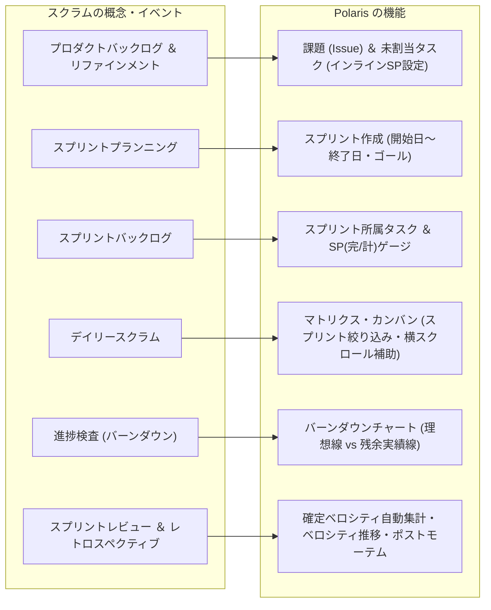
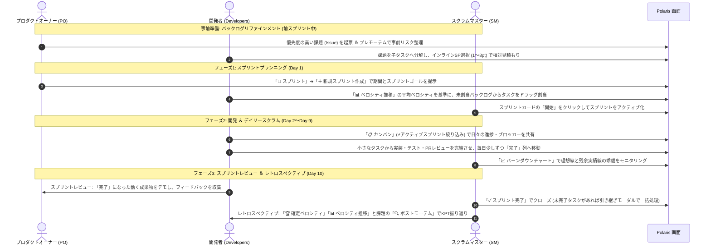

# Polaris スクラム実践スタートガイド (Scrum Starter Guide)

本書は、スクラム開発の基本原則（公式『スクラムガイド』準拠）と、Polaris のアジャイル機能（スプリント、ストーリーポイント、カンバン、バーンダウン、ベロシティ推移、プレ／ポストモーテム）および品質保証原則（[`docs/testing_lessons_and_guidelines.md`](testing_lessons_and_guidelines.md)）を統合し、**初めてのチームでも迷わず高品質なスクラム開発を立ち上げ・運用するための実践ガイドブック**です。

---

## 1. はじめに: スクラムの3本柱と Polaris の役割

スクラムは、複雑なプロダクト開発を短いサイクル（スプリント）で反復しながら進めるフレームワークであり、以下の **「経験主義の3本柱」** を土台としています：

1. **透明性 (Transparency)**: 作業の状況、進捗、課題がチーム全員に同じ基準で見えていること（Polaris のカンバン・バーンダウン・Doneの定義で可視化）。
2. **検査 (Inspection)**: スプリントゴールに向けた進捗や成果物を高頻度でチェックし、問題を早期発見すること（デイリースクラム・スプリントレビューで実践）。
3. **適応 (Adaptation)**: 検査でズレや問題が見つかった際、計画やプロセスの改善を即座に行うこと（スコープ調整・レトロスペクティブ・ポストモーテムで実践）。

多くの現場では「アジャイルのベロシティ管理（ストーリーポイント）」と「現実のスケジュール・工数管理（時間・ガントチャート）」が分断されがちですが、Polaris はこの2つを統合した**ハイブリッド・プロジェクト管理システム**として機能します：
- **相対規模（ストーリーポイント）**: スプリント計画、チームキャパシティ（ベロシティ）、バーンダウン分析に使用
- **絶対時間（予定・実績工数）**: 日々の工数集計、予実差異分析、ガントチャート連動に使用
- **ビルトイン品質保証**: 不具合の事後分析（Post-Mortem）に基づく受入チェックリストと直結し、技術的負債を溜めないスプリント運用を実現

---

## 2. スクラムの体制（3つの役割）と Polaris 機能対応マップ

### 2.1 スクラムチームの3つの役割（アカウンタビリティ）

スクラムチームには階層（上下関係）はなく、以下の **3つの明確な役割** を持つメンバーが対等に協力してゴールを目指します：

| 役割（ロール） | 責任（アカウンタビリティ） | Polaris 上での主なアクション |
| :--- | :--- | :--- |
| **プロダクトオーナー (PO)** | **「何を作るか（Why / What）」と価値の最大化**に責任を持つ。要求の優先順位を決め、スプリントゴールを提示する。 | ・親課題（Issue）の起票と優先順位付け ・スプリントゴールの設定 ・スプリントレビューでの成果物受入確認 |
| **開発者 (Developers)** | **「どう作るか（How）」と成果物の品質（Doneの定義）** に責任を持つ。計画・見積もり・実装・テストを自己管理で行う。 | ・課題から子タスクへの分解と SP 相対見積もり ・カンバンでの日々のステータス更新・実績工数記録 ・Doneの定義（DoD）に基づく実装・自動テスト・PRレビュー |
| **スクラムマスター (SM)** | **スクラムの確立とチームの生産性・健全性**に責任を持つ。イベントの進行支援や障害（ブロッカー）の除去を行う。 | ・バーンダウンチャートやベロシティ推移のモニタリング ・遅延やブロッカー検知時のスコープ調整ファシリテート ・プレモーテム／ポストモーテムを用いた振り返り支援 |

> [!TIP]
> 小規模なチームでは、プロジェクトマネージャーやテックリードが PO や SM の役割を兼務することもありますが、「いま自分は PO（何を作るか）の視点で話しているのか、開発者（どう作るか）の視点で話しているのか」を意識して切り分けることがスクラム成功の鍵です。

### 2.2 スクラム概念 × Polaris 機能対応マップ

| スクラム概念 | Polaris での対応機能 | 画面上の場所 | 主な役割 |
| :--- | :--- | :--- | :--- |
| **プロダクトバックログ** | 課題一覧 / 未割当タスク | 「📋 カンバン」または「🏃 スプリント」の未割当バックログ | 将来実装すべき要求やフィーチャーの優先順位付きストック |
| **スプリント** | スプリントエンティティ ＆ プロジェクトのデフォルトスプリント期間 | 「🏃 スプリント」タブ ➔ **「＋ 新規スプリント作成」**（プロジェクト設定の「デフォルトのスプリント期間」に基づき開始日・終了日を自動入力） | 1〜2週間の固定期間タイムボックス（開始日・終了日・ゴール） |
| **ストーリーポイント** | タスクの SP 属性 | タスク詳細「🏃 スプリント ＆ ストーリーポイント設定」またはタスク行の**インラインSP選択** | 作業の相対規模・複雑さ・不確実性の見積もり値 |
| **スプリントバックログ** | スプリント所属タスク | 「🏃 スプリント」内の各スプリントカード | 今スプリントで「Done」にコミットする作業項目群 |
| **デイリースクラム** | カンバンボード | 「📋 カンバン」タブ（フィルタ「⚡ アクティブスプリントのみ」） | 課題スイムレーン × ステータス列での15分間の作戦会議 |
| **スプリント進捗追跡** | バーンダウンチャート | 「🏃 スプリント」➔ **「📈 バーンダウンチャート」** サブタブ | 理想線と残余実績線の乖離から遅延リスクを早期検知 |
| **ベロシティ (Velocity)** | 完了タスクの SP **自動集計** | 進行中スプリントのバナー「⚡ 消化 X / Y SP (Z%)」、カードの「SP(完/計)」、完了カードの「🏆 確定ベロシティ: X SP」、**「📊 ベロシティ推移」** サブタブ | チームが1スプリントで「完了」にできたポイント量。次スプリントの計画上限（キャパシティ）の基準になる |

> [!NOTE]
> 「完了 SP」は、完了ステータスのタスク（または進捗率 100% のタスク）の SP 合計として自動算出されます。スプリントに割り当てた全タスクの SP 合計は「計画 SP」（`Y`）として併記されます。

---

## 3. ストーリーポイント（SP）相対見積もりとプランニングポーカー

### 3.1 なぜ「時間」ではなく「ポイント」で見積もるのか？
- **ストーリーポイント (SP)**: 「タスクの規模・複雑さ・未知のリスク」を表す**相対的な大きさ**。誰が担当しても（シニアでもジュニアでも）同じタスクなら同じポイントになります。これにより「チーム全体で1スプリントにどれだけの規模を消化できるか（ベロシティ）」が安定して計測できます。
- **工数（時間）**: 「特定の担当者がそのタスクを実装するのにかかる実時間」。日々の稼働管理やコスト計算には有用ですが、担当者の熟練度で変動するためチームの基礎体力測定には向きません。Polaris では両方を併用できます。

### 3.2 フィボナッチ数列による見積もり基準表

人間は「7と8の違い」のような細かい差を正確に見積もることは苦手ですが、「昨日のタスクより倍くらい大変か、同じくらいか」という**相対比較**は得意です。そのため、数値が大きくなるほど間隔が広がる**フィボナッチ数列（1, 2, 3, 5, 8, 13, 21）** を使用します。

| ポイント | 規模の目安 | 具体例（Web/API開発） | 判断基準 |
| :---: | :--- | :--- | :--- |
| **1 pt** | 極めて単純・自明 | 文言変更、環境変数追加、定数定義、Typo修正 | 調査不要、仕組みが完全に分かっておりすぐ終わる |
| **2 pt** | 軽微な改修 | 既存画面への項目追加、単純なバリデーション追加 | 実装パターンが確立されており迷いがない |
| **3 pt** | **【チーム基準】標準タスク** | 単一テーブルのCRUD API、標準的な新規Vueコンポーネント | **見積もりの物差し（基準）**。単体テストを含めて無理なく完結できる |
| **5 pt** | やや複雑・調査が必要 | 複数テーブルの集計処理、外部API連携、認証認可ロジック | 考慮すべきエッジケースや複数箇所への影響がある |
| **8 pt** | 重いタスク（1タスクの上限目安） | 画面全体のゼロベース構築、複雑なステート管理・トランザクション | 1スプリント内で完結できるギリギリの大きさ。可能なら分割を検討 |
| **13 pt〜** | **大きすぎるタスク（分割必須）** | 「○○機能の全面刷新」「決済基盤の統合」など | **そのままスプリントに入れてはならない**。不確実性が高すぎるため、親課題（Issue）とし、複数の 2〜5pt タスクに分解する |

> 💡 **基準タスク（アンカー）の決め方**:
> 初めてスクラムを導入する際は、過去にチーム全員が経験した「ごく標準的なタスク」を1つ選び、**「これを私たちの 3 pt の基準（物差し）にしよう」** と合意することから始めてください。以降の見積もりはすべて「あの 3 pt のタスクと比べて小さいか（1〜2pt）、同じくらいか（3pt）、ひと回り大きいか（5pt）」で判断します。

### 3.3 プランニングポーカーとバックログリファインメント（事前手入れ）

1. **プランニングポーカー（合意形成のやり方）**:
   - 見積もりをする際、詳しい人が最初に「これは 3pt だね」と言ってしまうと、他のメンバーが疑問を持っていても同調してしまいます（アンカリング効果）。
   - これを防ぐため、対象タスクの内容を確認したら、全員で同時にポイント（指やチャット、カード）を出します。
   - もし「2pt」と「8pt」のように割れたら、**一番低い人と高い人がそれぞれの理由（「既存の共通関数が使えると思った」「いや、権限周りのエッジケースがある」）を話し合います**。これにより、着手前に仕様の抜け漏れやリスクが浮き彫りになります。合意できたら Polaris のタスク行の**インライン SP クイック選択**で即座にポイントを記録します。
2. **バックログリファインメント（スプリント前の事前準備）**:
   - スプリントプランニング当日にゼロから課題を分解・見積もりすると時間が足りなくなります。
   - **前スプリントの期間中（週に1回・30〜60分程度）** に、次スプリントで着手しそうな親課題（Issue）について、プレモーテム（事前リスク予測）の記入、子タスクへの分解、および SP の見積もりをあらかじめ済ませておきます。

---

## 4. スプリントのライフサイクル ＆ Polaris 操作手順（ステップ・バイ・ステップ）

一般的な **2週間スプリント（10営業日）** の運用フローに沿って、各スクラムイベントの目的と Polaris の操作手順を解説します。

### ステップ1: スプリントプランニング（Day 1 前半：Why と What の合意）
スプリントプランニングでは、**「① なぜこのスプリントをやるのか（スプリントゴール）」「② どのタスクをスプリントに入れるか（What）」「③ どう実現するか（How）」** を決定します。
1. プロジェクトワークスペース上部の「🏃 スプリント」タブを開きます。
2. **「📊 ベロシティ推移」** サブタブを開き、チームの過去の **「平均ベロシティ（Closed平均）」** を確認します（初回スプリントの場合は仮の目安として 20〜30 SP 等をチームで合意します）。
3. **「📋 スプリント計画」** サブタブに戻り、**「＋ 新規スプリント作成」** をクリックします。
   - **スプリント名**: `Sprint 1`
   - **スプリントゴール**: `コア機能MVPの完成と認証フローの動作確認`（単なるタスクの羅列ではなく、このスプリントで達成したいビジネス上の目的を一文で書きます）
   - **開始日・終了日（自動計算）**:
     - **開始日**: 既存スプリントの最大終了日の翌日（初回スプリントの場合は本日）が自動でセットされます。
     - **終了日**: プロジェクト設定（`⚙️ 設定` ➔ `デフォルトスプリント期間 (日)`、デフォルト: 14日間＝2週間、1〜90日の範囲で変更可能）に基づき、`開始日 + 期間日数 - 1日` が自動計算されて入力されます（開始日を変更すると終了日も連動して自動再計算されます）。内容を確認して「保存」をクリックします。

### ステップ2: スプリントバックログの確定と開始（Day 1 後半）
1. 右側の「未割当バックログ」にあるタスク（リファインメントで見積もり済みのもの、またはその場でタスク行の**インライン SP クイック選択** `1, 2, 3, 5, 8, 13, 21 SP` で見積もったもの）を、左側の作成したスプリントカードへドラッグ＆ドロップ（または「スプリントへ割当」プルダウンで選択）します。
   - タスク詳細画面の **「🏃 スプリント ＆ ストーリーポイント設定」** エリアからも設定・変更できます。
2. スプリントカードのメトリクスバー **「SP(完/計): X / Y SP (Z%)」** に表示される計画 SP（`Y`）が、チームの平均ベロシティ（キャパシティ）以内に収まっていることを確認します。
   - ⚠️ **過積載の禁止**: 平均ベロシティが 20 SP のチームが「気合で 35 SP 入れる」のはアンチパターンです。無理のない量をコミットし、早く終わればバックログから追加で引っ張ります。
3. 準備が整ったら、「計画中」のスプリントカードの **「開始」** ボタンをクリックし、ステータスを `active` に切り替えます。

### ステップ3: デイリースクラムとカンバンボードの運用（Day 2〜Day 9）
デイリースクラムは、**毎日同じ時間・15分以内** で行う「開発者のための作戦会議」です。上司への業務報告会ではなく、**「スプリントゴール達成に向けて今日どう動くか・困っていること（ブロッカー）はないか」** を調整します。
1. 毎朝のデイリースクラムでは「📋 カンバン」タブを開きます。
2. 画面上部のフィルタバーにある **「スプリント:」** で **「⚡ アクティブスプリントのみ」** を選択します。これにより、今回のスプリントに関係ないバックログタスクが隠れ、今やるべきタスクだけに集中できます（このフィルタはガント・テーブルでも共通して機能します）。
3. **横スクロール補助機能の活用**:
   - 列数が多い場合は、**上部連動スクロールバー**やツールバーの **「◀」「▶」ボタン**、**「📍 列へ移動...」** セレクトボックスを使って目的のステータス列へ素早く移動します。
4. **デイリースクラムではカンバンの「右側（完了に近い列）」から順番に確認**します：
   - 新しく「未着手」のタスクを始めることよりも、**いま「レビュー中」や「進行中」にあるタスクを今日中に「完了（Done）」へ押し出すこと（仕掛かり作業 WIP を減らすこと）** を最優先にします。
5. タスク詳細画面では、日々の「実績工数」欄の **+0.5h / +1.0h / +2.0h チップ**で実稼働時間をクイック加算し、`Ctrl+S`（または下部フローティング保存バー）で素早く保存します。

### ステップ4: バーンダウンチャートとガントチャートによる進捗検査
1. スプリント画面の **「📈 バーンダウンチャート」** サブタブ（または進行中スプリントバナーの **「📈 バーンダウンを見る」**）を開きます（指標は SP / 時間で切替可能）。
2. **理想バーンダウン線（グレーの破線）** と **残余実績線（テーマカラーの実線）** を比較します：
   - 残余実績線が理想線より**下**: 予定より早く消化が進んでいる（順調）。
   - 残余実績線が理想線より**上（横ばいが続いている）**: タスクが大きすぎて完了できていないか、ブロッカーが発生して滞留しているサインです。
3. 乖離が大きい場合は、スプリント最終日を待たずに PO と開発者で相談し、優先度の低いタスクの「バックログへ戻す」ボタン（または未割当バックログへのドラッグ、`sprint_id: null`）でスコープを調整してスプリントゴールを守ります。
4. **ガントチャートでのスプリント期間と中長期俯瞰**:
   - 「📅 ガント」タブでは、タイムライン上部に **「🏃 スプリント名」の期間帯** がオーバーレイ表示されるため、タスクの予定日がスプリント期間からハミ出していないかを視覚的にチェックできます。
   - スケール切替で **「日」**（1日 48px・30日間・日単位調整）、**「週」**（1日 16px・91日間・週単位バケット）、**「月」**（1日 6px・180日間・月単位バケット）を切り替え、複数スプリントにまたがるマイルストーンを俯瞰できます。

### ステップ5: スプリントレビュー（Day 10 前半：成果物の検査）
スプリント最終日に行う1つ目のイベントが **スプリントレビュー** です。対象は **「作ったプロダクト（What）」** です。
1. **「Doneの定義（DoD）」を満たして「完了」列に入ったタスクのみ** を成果物（インクリメント）として、PO やステークホルダーに実際の画面を動かしながらデモンストレーションします。
2. 「まだテストが終わっていない90%完了のタスク」はデモに含めません（未完了として扱います）。
3. デモを通じて得られた「ここはもっとこうした方が使いやすい」「次はあの機能が欲しい」というフィードバックを、新たな課題・タスクとしてプロダクトバックログへ追加・調整します。

### ステップ6: スプリントレトロスペクティブ（Day 10 後半：プロセスの振り返り）とスプリント完了化
スプリント最終日の最後に行うイベントが **スプリントレトロスペクティブ（振り返り）** です。対象は **「チームの進め方・協力体制・品質・ツール（How）」** です。
1. アクティブスプリントのヘッダーの **「✓ スプリント完了」**（またはスプリントカードの「完了」）をクリックします。
2. **未完了タスクが残っている場合は引き継ぎモーダルが自動で開きます**（単一トランザクションで安全に一括処理されます）：
   - **「次の計画中スプリントへ一括移動」**（次期スプリントが未作成の場合は自動生成して引き継ぎます）
   - **「未割当バックログへ一括返却」**（`sprint_id = null`）
   - **「移動せずこのままスプリントを完了する」**
3. クローズ後、スプリントカードに **「🏆 確定ベロシティ: X SP」** が自動表示されます。あわせて **「📊 ベロシティ推移」** サブタブを開き、「計画 SP に対して何%完了できたか」「平均ベロシティはどう推移しているか」を確認します。
4. 完了した親課題（Issue）の詳細画面にある **「🔍 ポストモーテム（事後振り返り）」** パネルを開き、**「📋 テンプレート挿入（実績引用）」** をクリックします：
   - 予定 vs 実績の期間・工数・完了 SP が自動引用された状態で、**Keep（良かったこと・続けたいこと） / Problem（発生した問題・根本原因） / Try（次スプリントで試す改善アクション）** をチーム全員で記入します。
   - 個人を責める（Blame）のではなく、「なぜその問題が起きたのか（仕組み・プロセスの原因）」に焦点を当て、**次スプリントで実行する具体的な Try を1〜2個に絞って決定**します。
   - 振り返り結果は **「📚 Wikiへ振り返り記事として保存」** ボタンでプロジェクト Wiki へワンクリックで蓄積できます。

---

## 5. 品質保証ガイドライン連動「Doneの定義 (Definition of Done: DoD)」

アジャイル開発で最も陥りやすい失敗は、「スピードを優先するあまりテストが疎かになり、スプリントを重ねるごとにバグ修正（技術的負債）でベロシティが落ちていくこと」です。

スクラムでは、各タスクが「完了した」とみなされるための共通の品質基準を **「Doneの定義（Definition of Done: DoD）」** と呼びます。Polaris では、[`docs/testing_lessons_and_guidelines.md`](testing_lessons_and_guidelines.md) に基づき、**以下の基準をすべて満たしたタスクのみ「完了（Done）」列へ移動する**というチーム運用ルールを推奨します：

### 事前・事後のリスク＆振り返り管理（プレモーテム / ポストモーテム）
課題の詳細画面には、「🛡️ プレモーテム（事前リスク予測）」と「🔍 ポストモーテム（事後振り返り）」の記入欄があります（Markdown）。
- **🛡️ プレモーテム（着手前）**: リファインメントや着手前に「もしこの課題が失敗・炎上するとしたら何が原因か？」を想定し、予防アクションを子タスクや設計に織り込みます。
- **🔍 ポストモーテム（完了後）**: 完了後や問題発生時に、計画とのギャップ・根本原因・再発防止策（KPT）を記録し、Wiki へナレッジとしてエクスポートします。

### チーム共通の「Doneの定義 (DoD)」チェックリスト
- [ ] **機能要件の充足**: タスクの要求事項・受入条件がすべて実装されていること。
- [ ] **送受信完全一致（Round-trip 検証）**:
  - API で保存した値が、画面の再読み込みや GET 再取得後も 1文字の欠落もなく完全に維持されていること（[原則1: Round-trip Assertion](testing_lessons_and_guidelines.md#原則1-round-trip-assertion浅いテストの禁止) 参照）。
- [ ] **未設定化と省略時保持（Full Lifecycle ＆ Clear to Null 検証）**:
  - 値を消去（空欄や未割当を選択）して保存した際に正しく初期状態（NULL）にリセットされ、部分更新時に他フィールドが消えないこと（[原則2: Full Lifecycle ＆ Clear to Null](testing_lessons_and_guidelines.md#原則2-full-lifecycle--clear-to-nullクリア挙動の網羅) 参照）。
- [ ] **自動テストの合格（本番モジュール直接インポート）**:
  - バックエンド: `go test -count=1 ./...` 全件 PASS
  - フロントエンド: `npm test` 全件 PASS ＆ `npm run build` エラーゼロ（[原則6: Authoritative Data Source & Direct Module Import](testing_lessons_and_guidelines.md#原則6-authoritative-data-source--direct-module-import集計データ分離と本番モジュール直接インポート) 参照）。
- [ ] **UI/UX 操作性検証**:
  - モーダル内でテキストをドラッグ選択し、モーダル外（背景）でマウスボタンを離しても、モーダルが誤って閉じないこと（[事例4](testing_lessons_and_guidelines.md#事例4-モーダル内テキスト選択ドラッグ時の意図しない誤閉鎖-pr-19) 参照）。
  - ブラウザやマウスの「戻るボタン」で直前のワークスペース画面に正常復帰できること。
  - 日本語テキストがテーブル列やバッジで不自然に改行されていないこと（[事例6](testing_lessons_and_guidelines.md#事例6-システム権限マトリクス種別列の不自然な折り返し-pr-21) 参照）。

---

## 6. すぐに使える「2週間スプリント」実践スケジュール

> [!IMPORTANT]
> **⚠️ アンチパターン「ミニ・ウォーターフォール（後半まとめテスト）」を避けましょう**  
> 「スプリント前半（Day 2〜5）は実装だけを進め、後半（Day 6〜9）にまとめてテスト・レビューする」という進め方をすると、Day 8 まで完了タスクが 0 SP のままバーンダウンが横ばいになり、最終日付近でバグが噴出してスプリントが破綻します。  
> スクラムの鉄則は **「小さなタスク（1〜5pt）を1つ着手したら、実装・自動テスト・PRレビュー・マージ（DoD達成）までを一気に完結させて『完了』列へ動かし、Day 2〜3 の序盤から毎日少しずつ Done を積み上げる」** ことです。

| 日程 | スクラムイベント / 活動 | Polaris 上のアクション | チェック項目 |
| :---: | :--- | :--- | :--- |
| **Day 1 (月)** | **スプリントプランニング** | ・「📊 ベロシティ推移」で過去平均ベロシティを確認 ・「＋ 新規スプリント作成」（開始日・終了日・ゴール入力） ・未割当バックログからタスクを割り当て ➔ カードの **「開始」** | [ ] スプリントゴールが明確か [ ] 計画 SP が平均ベロシティ（キャパシティ）以内か |
| **Day 2〜4 (火〜木)** | **デイリースクラム ＆ 序盤タスクの Done 積み上げ** | ・カンバン（⚡アクティブスプリント絞り込み）で右側の列から状況確認 ・1〜3pt の小〜中規模タスクを **実装➔テスト➔PRマージまで完結** させ、順次「完了」列へ移動 ・実績工数をチップで加算 ＆ `Ctrl+S` で保存 | [ ] 仕掛かり中（進行中）のタスクを増やしすぎていないか [ ] 序盤から「完了」に入るタスクが出始めているか |
| **Day 5 (金)** | **スプリント中間チェック ＆ バックログリファインメント** | ・「📈 バーンダウンチャート」で理想線との乖離を確認（遅れていれば早期にスコープ調整） ・**次スプリント候補の親課題（Issue）のプレモーテム記入・子タスク分解・プランニングポーカー（インラインSP設定）** を実施 | [ ] 遅延タスクやブロッカーが放置されていないか [ ] 次スプリントに向けたバックログの手入れができたか |
| **Day 6〜8 (月〜水)** | **デイリースクラム ＆ 残タスクの継続的 Done 化** | ・残りのタスクについても 1件ずつ DoD（Round-trip検証・`go test` / `npm test`）を満たして「完了」列へ移動 ・ガントチャートのスプリント期間帯（🏃）と予定・実績バーのズレを確認 | [ ] 消化 SP（⚡ 消化 X / Y SP）が着実に増えているか [ ] DoD チェックリストを妥協せず満たしているか |
| **Day 9 (木)** | **スプリントゴール達成確認 ＆ デモ準備** | ・全完了タスクの統合動作確認（検証環境がある場合はステージング確認） ・翌日のスプリントレビューに向けたデモシナリオの確認 | [ ] スプリントゴールを達成できる状態にあるか [ ] 未完了になりそうなタスクの整理ができたか |
| **Day 10 (金)** | **スプリントレビュー ＆ レトロスペクティブ** | ・**レビュー**: 「完了」タスクの動く画面をデモし、フィードバックをバックログへ追加 ・**完了処理**: 「✓ スプリント完了」をクリック（未完了タスクは引き継ぎモーダルで次スプリントまたはバックログへ一括移動） ・**レトロスペクティブ**: 「🏆 確定ベロシティ」「📊 ベロシティ推移」を確認し、課題の「🔍 ポストモーテム」で KPT を記入 ➔ Wiki へ保存 | [ ] 確定ベロシティを確認し次回の計画基準にしたか [ ] 次スプリントで実践する改善アクション（Try）を1〜2個決めたか |

---

## 7. まとめ
スクラムは「決まった儀式をこなすこと」が目的ではなく、**「短いサイクルで価値ある動くソフトウェアを届け続け、チームとプロダクトを継続的に改善すること」** が目的です。  
Polaris のアジャイル機能と [品質保証ガイドライン](testing_lessons_and_guidelines.md) を組み合わせ、**「持続可能で、手戻りのない高品質なスクラム開発」** をチーム全体で実践してください。
