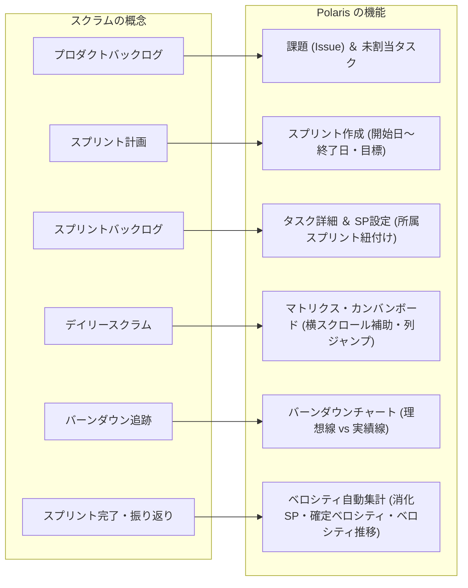
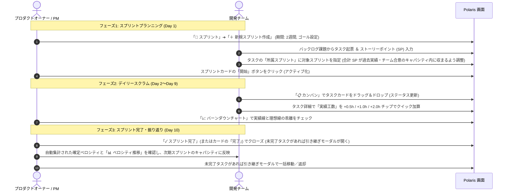

# Polaris スクラム実践スタートガイド (Scrum Starter Guide)

本書は、Polaris のアジャイル機能（スプリント、ストーリーポイント、カンバン、バーンダウンチャート）と、確立された品質保証原則（`docs/testing_lessons_and_guidelines.md`）を活用して、**チームが最短で高品質なスクラム開発を立ち上げ・運用するための実践的ガイドブック**です。

---

## 1. はじめに: なぜ Polaris でスクラムを行うのか？

多くのプロジェクト管理ツールでは、「アジャイルのベロシティ管理（ストーリーポイント）」と「従来の進捗・工数管理（時間・ガントチャート）」が分断されがちです。

Polaris は、この2つを高い次元で統合した**ハイブリッド・プロジェクト管理システム**です：
- **相対規模（ストーリーポイント）**: スプリント計画、チームキャパシティ、バーンダウン分析に使用
- **絶対時間（予定・実績工数）**: 日々の工数集計、予実差異分析、ガントチャート連動に使用
- **ビルトイン品質保証**: 不具合の事後分析（Post-Mortem）に基づく受入チェックリストと直結し、技術的負債を溜めないスプリント運用を実現

---

## 2. スクラム概念 × Polaris 機能対応マップ

スクラムの標準的な枠組みと、Polaris の画面・機能は以下のように直感的に対応しています：

| スクラム概念 | Polaris での対応機能 | 画面上の場所 | 主な役割 |
| :--- | :--- | :--- | :--- |
| **プロダクトバックログ** | 課題一覧 / 未割当タスク | 「📋 カンバン」または「🏃 スプリント」の未割当リスト | 将来実装すべき要求やフィーチャーのストック |
| **スプリント** | スプリントエンティティ | 「🏃 スプリント」タブ ➔「＋ 新規スプリント作成」 | 1〜2週間のタイムボックス（開始日・終了日・ゴール） |
| **ストーリーポイント** | タスクの SP 属性 | タスク詳細「🏃 スプリント ＆ ストーリーポイント設定」 | 作業の相対規模・難易度・不確実性の見積もり値 |
| **スプリントバックログ** | スプリント所属タスク | 「🏃 スプリント」内の各スプリントカード | 今スプリントで「Done」にコミットする作業項目群 |
| **デイリースクラム** | カンバンボード | 「📋 カンバン」タブ | 課題スイムレーン × ステータス列での日々の状況共有 |
| **スプリント進捗追跡** | バーンダウンチャート | 「🏃 スプリント」➔「📈 バーンダウンチャート」サブタブ | 理想線と実績線の乖離から遅延リスクを早期検知 |
| **ベロシティ (Velocity)** | 完了タスクの SP **自動集計** | 進行中スプリントのバナー「⚡ 消化 X / Y SP (Z%)」、スプリントカードの「SP(完/計)」、クローズ済みカードの「🏆 確定ベロシティ: X SP」、「📊 ベロシティ推移」サブタブ | チームが1スプリントで消化できたポイント量。「完了」扱いのステータスのタスクの SP が自動で合算される |

> [!NOTE]
> 「完了 SP」は、完了ステータスのタスクの SP 合計です。スプリントに割り当てた全タスクの SP 合計は「計画 SP」（`Y`）として別に表示されます。

---

## 3. ストーリーポイント（SP）相対見積もり実践ルール

### 3.1 時間（工数）とストーリーポイントの明確な使い分け
- **ストーリーポイント (SP)**: 「タスクの規模・複雑さ・未知のリスク」。担当者の経験値（シニア/ジュニア）に依存しない不変のボリューム。
- **工数（時間）**: 「特定の実装者がそのタスクを完了するのにかかる時間」。

### 3.2 フィボナッチ数列による見積もり基準表

チーム全員で見積もりのブレをなくすため、以下の基準表を合意・運用します：

| ポイント | 規模の目安 | 具体例（Web/API開発） | 判断基準 |
| :---: | :--- | :--- | :--- |
| **1 pt** | 極めて単純・自明 | 文言変更、環境変数追加、定数定義、Typo修正 | 調査不要、30分〜1時間程度で完了 |
| **2 pt** | 軽微な改修 | 既存画面への項目追加、単純なバリデーション追加 | 実装パターンが確立されており迷いがない |
| **3 pt** | **【チーム基準】標準タスク** | 単一テーブルのCRUD API、標準的な新規Vueコンポーネント | 設計が自明で、単体テストを含めて無理なく完了できる |
| **5 pt** | やや複雑・少し調査が必要 | 複数テーブルの集計処理、外部API連携、認証認可ロジック | 考慮すべきエッジケースやデータ不整合リスクが存在 |
| **8 pt** | 重いタスク（本ガイド例では「1タスクの上限」） | 画面全体のゼロベース構築、複雑なステート管理・WebSocket | 1人のメンバーが数日間集中する必要がある |
| **13 pt〜** | **大きすぎるタスク（分割必須）** | 「○○機能の全面刷新」「決済基盤の統合」など | **そのままスプリントに入れてはならない**。親課題（Issue）とし、複数の 2〜5pt タスクに分解する |

> 💡 **チーム合意事項**: 「8 pt を1スプリント内に収めるタスクの上限とする」「13 pt 以上は分割する」は Polaris の機能的な制約ではなく、**チームで合意する運用ルール（例）** です。

> 💡 **基準タスクの決定**:
> 初めてスクラムを導入する場合、過去にチームで実装した「標準的なタスク」を1つ選び、**「これを 3 pt の基準としよう」** とチーム全員で合意することから始めてください。

---

## 4. スプリントのライフサイクル ＆ Polaris 操作手順（ステップ・バイ・ステップ）

一般的な **2週間スプリント（10営業日）** の運用フローに沿って解説します。

### ステップ1: スプリントの作成（プランニング）
1. プロジェクトワークスペース上部の「🏃 スプリント」タブを開きます。
2. **「＋ 新規スプリント作成」** をクリックします。
   - **スプリント名**: `Sprint 1`
   - **スプリントゴール**: `コア機能MVPの完成と認証フローの動作確認`
   - **開始日・終了日**: カレンダーから開始日と終了日（2週間後）を選択します（保存した日付は再読み込み後も保持されます。[Round-trip 検証の教訓](testing_lessons_and_guidelines.md#事例1-スプリント開始日終了日のサイレント欠落-pr-22) 参照）。
3. モーダル下部の「保存」をクリックして作成します（「スプリントを作成しました」と通知されます）。

### ステップ2: タスクの見積もりと割り当て
1. 課題（Issue）から子タスクを作成するか、既存タスクの詳細画面を開きます。
2. **「🏃 スプリント ＆ ストーリーポイント設定」** エリアを開きます：
   - **ストーリーポイント (SP)**: 相対見積もり値（例: `3`, `5`）を入力。
   - **所属スプリント**: 先ほど作成したスプリントを選択。
3. **「変更を保存」** をクリックします（スプリント紐付けと SP が保存されます。[関連する教訓](testing_lessons_and_guidelines.md#事例2-タスク詳細でのスプリントidストーリーポイント未保存-pr-23) 参照）。
   - バックログ／スプリントのタスク行では、SP を**インライン クイック選択**（`1, 2, 3, 5, 8, 13, 21 SP`）でも設定できます。タスク詳細を開かずに素早く見積もりを入力できます。
4. スプリントカードの「SP(完/計): X / Y SP (Z%)」（進捗バー付き）、進行中スプリントのバナー「⚡ 消化 X / Y SP (Z%)」「完了 A / B タスク」で、計画 SP（`Y`）を確認し、チームのキャパシティを超えていないか確認します（キャパシティは例として 20〜30 SP。チームの過去実績に合わせて設定してください）。
5. 準備が整ったら、「計画中」のスプリントカードの **「開始」** ボタンをクリックし（確認ダイアログで承認）、ステータスを `active` に切り替えます。

### ステップ3: デイリースクラムとカンバンボードの運用
1. 毎朝のデイリースクラムでは「📋 カンバン」タブを開きます。
2. **横スクロール補助機能の活用**:
   - 列数が多い場合は、上部に固定表示されるスリムな**上部連動スクロールバー**で素早く横移動。
   - ツールバーの **「◀」「▶」ボタン**（ツールチップ: 左へスクロール / 右へスクロール）で1列ずつスクロール。
   - **「📍 列へ移動...」** セレクトボックスから、目的のステータス列（例:「レビュー中」）へ一発ジャンプ。
3. フィルタバーの「スプリント:」で表示対象を絞り込めます（「⚡ アクティブスプリントのみ」「未割当 (バックログ)」「個別のスプリント」）。この絞り込みはカンバン・ガント・テーブルで共通です。
4. 担当者は作業着手時にカードを「進行中」へドラッグし、完了時に「完了」へドラッグします。
5. タスク詳細で、日々の「実績工数」欄の **+0.5h / +1.0h / +2.0h チップ**を記録します。

### ステップ4: バーンダウンチャートでの遅延検知
1. スプリント画面の「📈 バーンダウンチャート」サブタブ（または進行中スプリントの「📈 バーンダウンを見る」）を開きます。指標は SP / 時間で切り替えられます。サブタブは「📋 スプリント計画」「📈 バーンダウンチャート」「📊 ベロシティ推移」の3つです。
2. **理想バーンダウン線（グレーの破線）** と **残余実績線（テーマカラーの実線）** を比較します：
   - 残余実績線が理想線より**下**: 予定より早く消化が進んでいる（順調）。
   - 残余実績線が理想線より**上**: タスクの消化が遅れている（遅延リスクあり）。
3. 乖離が大きい場合は、スプリント終了を待たずに「優先度の低いタスクをバックログへ戻す」スコープ調整（スプリントカード内のタスクの解除ボタン、または未割当バックログへのドラッグ、タスク詳細の所属スプリントを「(未割当バックログ)」に変更。API 上は `sprint_id: null`）を行います。

### ステップ4.5: ガントチャートでスプリント期間を俯瞰する
- ガントチャートには、スプリント期間が「🏃 スプリント名」の帯としてオーバーレイ表示されます。
- 表示スケールは「日」（1日 48px・表示 30 日）、「週」（週単位バケット 16px・表示 91 日）、「月」（月単位バケット 6px・表示 180 日）で切り替えます。スプリント計画の中長期の見通しには週・月が便利です。

### ステップ5: スプリントレビューと完了化（レトロスペクティブ）
1. スプリント最終日、すべての成果物を確認します。
2. アクティブスプリントのヘッダーの **「✓ スプリント完了」**（またはスプリントカードの「完了」）をクリックします。
3. **未完了タスクが残っている場合は引き継ぎモーダルが開き**、次のいずれかを選びます（未完了タスクが無ければ確認ダイアログのみ）：
   - 「次の計画中スプリントへ一括移動」
   - 「未割当バックログへ一括返却」（`sprint_id = null`）
   - 「移動せずこのままスプリントを完了する」（タスクは元のスプリントに残ります）
4. クローズ後、スプリントカードに **「🏆 確定ベロシティ: X SP」** が表示されます（完了タスクの SP の自動集計値。手動集計は不要です）。
5. Board の **「📊 ベロシティ推移」** サブタブで、平均ベロシティ（クローズ済み平均）・直近スプリントの消化 SP・全体平均の SP 消化率と、計画 SP vs 完了 SP の棒グラフを確認し、次スプリントのキャパシティ（例: 20〜30 SP はあくまで目安）に反映します。
   - 補足: スプリントを**削除**した場合は、配下のタスクは未割当バックログに戻ります。

---

## 5. 品質保証ガイドライン連動「Doneの定義 (Definition of Done: DoD)」

アジャイル開発で最も陥りやすい罠は、「スピードを優先するあまり、テストが疎かになり技術的負債が積み上がること」です。

Polaris では、[`docs/testing_lessons_and_guidelines.md`](testing_lessons_and_guidelines.md) に基づき、**以下の受入基準をすべて満たしたタスクのみ「完了（Done）」列へ移動する**というチーム運用ルールを定めます（Polaris がシステム的に移動を制限するものではありません）：

### 事前・事後の振り返り（プレモーテム / ポストモーテム）
課題の詳細画面には、「🛡️ プレモーテム（事前リスク予測）」と「🔍 ポストモーテム（事後振り返り）」の記入欄があります（Markdown）。
- **プレモーテム**: 着手前に「失敗するとしたら何が原因か」を洗い出し、予防策を記録します。
- **ポストモーテム**: 完了後に、不具合・遅延の原因と再発防止策を記録します。
- ワンクリックのテンプレートで雛形を挿入でき、「📚 Wikiへ振り返り記事として保存」でプロジェクト Wiki にナレッジとして残せます。

### タスク／課題詳細の保存操作
- 画面上部の固定バー、フォーム下部の保存ボタン、未保存時に表示されるフローティング保存バーのいずれからも保存できます。
- キーボードショートカット `Ctrl+S`（Mac は `Cmd+S`）でも「変更を保存」できます。

### チーム共通の「Doneの定義」チェックリスト
- [ ] **機能要件の充足**: タスクの要求事項が実装されていること。
- [ ] **送受信完全一致（Round-trip 検証）**:
  - API で保存した値が、画面の再読み込みや GET 再取得後も 1文字の欠落もなく完全に維持されていること（[原則1: Round-trip Assertion](testing_lessons_and_guidelines.md#原則1-round-trip-assertion浅いテストの禁止) 参照）。
- [ ] **未設定化（Clear to Null 検証）**:
  - 値を消去（空欄や未割当を選択）して保存した際、正しく初期状態（NULL）にリセットされること（[原則2: Full Lifecycle ＆ Clear to Null](testing_lessons_and_guidelines.md#原則2-full-lifecycle--clear-to-nullクリア挙動の網羅) 参照）。
- [ ] **自動テストの合格**:
  - バックエンド: `go test -count=1 ./...` 全件 PASS
  - フロントエンド: `npm test` 全件 PASS ＆ `npm run build` エラーゼロ
- [ ] **UI/UX 操作性検証**:
  - モーダル内でテキストをドラッグ選択し、モーダル外（背景）でマウスボタンを離しても、モーダルが誤って閉じないこと（[事例4](testing_lessons_and_guidelines.md#事例4-モーダル内テキスト選択ドラッグ時の意図しない誤閉鎖-pr-19) 参照）。
  - ブラウザやマウスの「戻るボタン」で直前のワークスペース画面に正常復帰できること。
  - 日本語テキストがテーブル列やバッジで不自然に改行されていないこと（[事例6](testing_lessons_and_guidelines.md#事例6-システム権限マトリクス種別列の不自然な折り返し-pr-21) 参照）。

---

## 6. すぐに使える「2週間スプリント」実践テンプレート

| 日程 | スクラムイベント | Polaris 上のアクション | チェック項目 |
| :---: | :--- | :--- | :--- |
| **Day 1 (月)** | **スプリントプランニング** | ・「＋ 新規スプリント作成」（開始日・終了日・ゴール入力） ・課題からタスク起票 ＆ SP 相対見積もり（1〜8pt） ・タスクをスプリントへ割り当て ➔ カードの「開始」 | [ ] スプリント期間が正しく保存されたか [ ] 計画 SP が「📊 ベロシティ推移」の平均ベロシティ・合意したキャパシティ以内か |
| **Day 2〜4 (火〜木)** | **開発 ＆ デイリースクラム** | ・カンバンでカードを「進行中」へ移動 ・実績工数をチップでクイック入力 ・バーンダウンチャートで初期消化ペースを確認 | [ ] カンバン上部スクロールバー・◀▶で快適に横移動できるか [ ] 予実差異が大きく開いていないか |
| **Day 5 (金)** | **スプリント中間チェック** | ・バーンダウンチャートと理想線の乖離度合いを確認 ・必要に応じて優先度の低いタスクをバックログへ戻す | [ ] 遅延タスクにブロッカーがないか [ ] スコープ調整が必要か |
| **Day 6〜8 (月〜水)** | **実装完了 ＆ テスト・レビュー** | ・Doneの定義（DoD）に基づきテストを実施（結合テストはチームの開発フローに応じて任意） ・PRレビュー ＆ マージ（`main` 同期） | [ ] Round-trip検証をパスしているか [ ] npm test / go test が全件PASSか |
| **Day 9 (木)** | **最終確認（ステージング等はチーム環境に応じて任意）** | ・（ステージング等の検証環境がある場合は動作確認） ・DoD を満たしたタスクカードを「完了」列へ移動 ・スプリントゴールの達成度を確認 | [ ] 残存バグ・手戻りがないか [ ] 未完了タスクの洗い出し |
| **Day 10 (金)** | **レビュー ＆ レトロスペクティブ** | ・成果物のデモ（スプリントレビュー） ・「✓ スプリント完了」でクローズ（未完了タスクは引き継ぎモーダルで次スプリントへ移動／バックログへ返却） ・「🏆 確定ベロシティ」と「📊 ベロシティ推移」を確認 ＆ 次回改善の振り返り（課題のポストモーテム活用） | [ ] 確定ベロシティを確認したか [ ] DoDチェックリストを更新すべき点はないか |

---

## 7. まとめ
Polaris のスクラム機能は、直感的な UI と堅牢なデータ永続化、そして [品質保証ガイドライン](testing_lessons_and_guidelines.md)（事後分析と継続更新規程）によって支えられています。  
本ガイドを活用し、**「持続可能で、手戻りのないアジャイル開発」** をチーム全体で実践してください。

