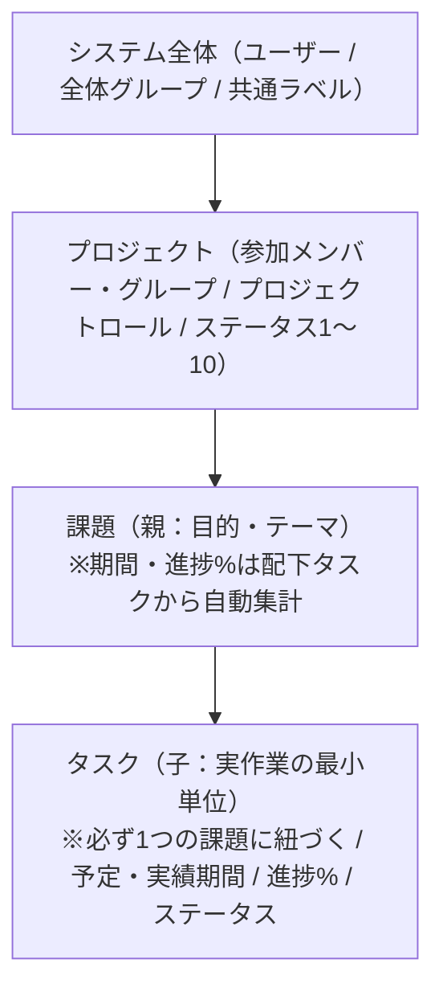

# プロジェクト管理Webアプリ 要件定義・基本設計書

これまでのヒアリング内容を元に、アプリケーションの全体仕様・データ構造・画面機能をまとめました。

---

## 1. 技術スタック・パッケージ方針・実行環境

「可能な限り外部パッケージを使用しない」方針に基づき、以下の最小構成とします。（※今後新たに外部パッケージが必要になった場合は、必ず事前に確認を行います）

| レイヤー | 技術 / 仕様 | 採用パッケージ（承認済み） | 自前実装・標準機能で対応する領域 |
| :--- | :--- | :--- | :--- |
| **Backend (API)** | Go（最新安定版） | - `github.com/lib/pq`（PostgreSQLドライバ） - `github.com/google/uuid`（**UUID v7** 生成用） - `firebase.google.com/go/v4`（FCMプッシュ通知送信用） - `golang.org/x/*`（準標準パッケージ扱い：`crypto`, `oauth2` 等） | - HTTPルーティング・ミドルウェア（Go標準 `net/http`） - セッション / トークン認証・権限チェック - メール送信（Go標準 `net/smtp` + `net.LookupMX`） - DBクエリ・トランザクション制御（`database/sql`） |
| **Frontend** | Nuxt 3 (Vue 3) **SPAモード (`ssr: false`)** | - `marked`（Markdownパーサー） - `dompurify`（XSSサニタイズ） - `lucide-vue-next`（アイコンコンポーネント） - `firebase`（`firebase/messaging`：FCMトークン取得・通知受信用） | - スタイリング（標準 Scoped CSS / CSS Variables / CSS Grid） - ドラッグ＆ドロップ（HTML5 Drag & Drop API / Pointer Events） - 状態管理（`useState`）・API通信（`$fetch` / `useFetch`）・日付処理 |
| **Database** | **PostgreSQL 17** | - | - 全テーブルの主キーに自動採番（SERIAL等）を使わず、アプリケーション側で生成した **UUID v7** を使用 |
| **開発環境・共通仕様** | Docker Compose | - コンテナ構成：`db` (PostgreSQL 17), `api` (Go), `web` (Nuxt 3), `mailpit` (開発用SMTP確認サーバー) | - **タイムゾーン**：DB内はすべて `TIMESTAMPTZ`（UTC）で保存し、画面表示・日付判定は **日本時間（JST / `Asia/Tokyo`）** 基準 - **UIデザイン・カラー**：白ベース（ライトモード：Slate系ハイコントラスト、高視認性） - **UI言語・フォント**：日本語 / Google Fonts **BIZ UDPGothic** |

---

## 2. コア概念とデータ階層

### 「課題」と「タスク」の関係性・ルール
1. **必須の親子階層**：すべての「タスク」は必ずいずれかの「課題」に紐づきます（親なしタスクは作らない）。
2. **単発作業への配慮**：課題作成時に「同名の初期タスクを同時に1つ作成する」オプションを用意し、1課題＝1タスクのケースでも手数を増やさずに登録可能とします。
3. **オーナーと委譲**：
   - 課題およびタスクにはそれぞれ **「オーナー（初期値は新規作成者）」** を設定します。
   - オーナーは、**現在のオーナー自身**または**プロジェクトの管理者（Admin）**によって、プロジェクト内の他メンバーへ**委譲（変更）可能**とします。
4. **役割分担とロールアップ（自動集計）・1日の基準時間**：
   - **1日あたりの基準時間設定（範囲：1〜24時間・小数点第2位まで）**：
     - システム全体設定（`manage_system` 権限）でアプリケーション全体のデフォルト値（例：8時間）を**小数点第2位まで**設定可能とし、各プロジェクト作成時にデフォルト値として引き継ぐとともに、プロジェクト設定（`Admin` ロール）でプロジェクトごとに **1〜24（小数点第2位まで）** の範囲で個別に変更可能とします。
   - **タスク（子）**：ステータス、予定開始・終了日、実績開始・終了日、**予定工数（h）・実績工数（h）**（**小数点第2位まで**入力可）、**予定コスト・実績コスト**（**小数点第2位まで**・0以上で双方入力可）、進捗率（0〜100%）、**担当者（複数ユーザー・グループ可）** を直接持ちます。
   - **課題（親）**：状態（`オープン` / `クローズ`）を持ち、配下タスクの予定日（最小開始日〜最大終了日）、実績日（最小開始日〜最大終了日）、**合計予定工数（h）・合計実績工数（h）**、**合計予定コスト・合計実績コスト**、**予定工数（未入力時は `予定日数 × プロジェクトの1日あたり基準時間`、両方未設定時は重み `1`）を重みとした加重平均進捗率（%）**、および **配下タスクの担当者全員（重複を除いた一覧）** を自動集計・集約して表示します。カンバンやガントチャートではクローズ済み課題をフィルタで非表示可能（デフォルトはオープンのみ表示）とします。
   - **プロジェクトレベルのコスト集計**：プロジェクト内の全タスクの予定コスト・実績コストをプロジェクト単位でも自動集計（`total_planned_cost`, `total_actual_cost`）し、プロジェクト一覧およびプロジェクト画面ヘッダーに表示します。
5. **課題削除時のルール**：配下にタスクが存在する課題を削除する場合は、確認ダイアログで配下タスク件数の警告を表示した上で、配下のタスク・コメントも一括削除（CASCADE）します。

---

## 3. ユーザー・グループ・権限モデル（3層構造）

### 3.1 ユーザー認証・セッション管理・初期セットアップ・メール変更・ドメイン制限・メール送信・グループ
- **認証方式とセッション管理**：
  - メールアドレス＋パスワード認証、および **Google OAuth 認証** に対応。
  - ログイン状態はDBの `user_sessions` テーブルと **`HttpOnly` Cookie** で管理し、ユーザーの無効化やメールアドレス・パスワード変更時に既存セッションをサーバー側で即時失効可能とする。
- **初期ユーザー（1人目のシステム管理者）の用意（ハイブリッド方式）**：
  1. **環境変数による自動作成**：API起動時に `users` テーブルが0件かつ環境変数（`INIT_ADMIN_EMAIL` 等）が指定されている場合、全システム権限を持つ初期管理者を自動作成する。
  2. **初回セットアップ画面**：環境変数が未設定で `users` が0件の場合、Webアクセス時に初期セットアップ画面（`/setup`）へ遷移し、画面から1人目を登録（パスワードまたはGoogle認証）すると全システム権限が付与される。1人目の作成後は `/setup` を無効化する。
- **2人目以降のユーザー追加（管理者による直接登録 または 招待制）**：
  - 自由なセルフサインアップは不可とし、`manage_system` 権限を持つ管理者が以下のいずれかの方法でユーザーを追加する。
    1. **直接アカウント登録（即時有効）**：管理者がメールアドレス・表示名・初期パスワード（8文字以上）を設定して直接アカウントを作成し、即時 `active` 状態でログイン可能とする。
    2. **事前登録・招待メール送信（72時間有効）**：管理者がメールアドレス・表示名を登録し、招待リンク付きメールを自動送信（および招待URLを発行）して本人が初期設定・有効化を行う。
- **ログインメールアドレスの変更・パスワード設定・パスワードリセット**：
  - **変更可能な主体**：ユーザー本人（自身のアカウント設定から）およびシステム管理者（`manage_system` 権限保持者）。
  - **本人確認と確認メール**：ユーザー本人が変更する場合は現在のパスワード確認を行った上で、新しいメールアドレス宛に本人確認リンク付きメールを送信し、リンクを踏んだ時点で変更を完了する（管理者が変更する場合はパスワード確認不要で即時変更または確認メール送信を選択可）。
  - **パスワードの設定・変更・リセット**：
    - Google認証のみで登録された（パスワード未設定の）ユーザーも、自身のアカウント設定からパスワードの新規設定を行える。
    - パスワードを忘れた場合は、ログイン画面からパスワードリセット（再設定リンク付きメール送信）を実行可能とする。
  - **Google認証との連動**：メールアドレス変更完了後は、変更後の新しいメールアドレスと一致するGoogleアカウントでログイン可能とする。
- **メール送信のタイミングと送信方式（ダイレクト送信 ＆ 外部SMTP設定）**：
  - **送信タイミング（有効期限付きワンタイムトークンURLを発行）**：
    1. 新規ユーザー招待メール（有効期限：**72時間**、管理画面から再送可能）
    2. パスワードリセット（パスワード忘れ）メール（有効期限：**1時間**）
    3. メールアドレス変更時の本人確認メール（有効期限：**1時間**）
  - **ユーザーの無効化（削除）ルール**：退職・離脱したユーザーはDBから物理削除せず「無効化（停止ステータス）」とし、ログインを不可にしつつ過去のコメント履歴や表示名を保持する。
  - **送信方式**：
    - **標準（外部SMTP未設定時）**：Go標準の `net.LookupMX` ＋ `net/smtp` を使用し、宛先ドメインのMXサーバーへダイレクト送信を行う。
    - **外部SMTP設定時**：`manage_system` 権限を持つ管理者がシステム管理画面から外部SMTPサーバー（Google Workspace SMTPリレー、Amazon SES、SendGrid等）を設定した場合、設定された外部SMTPサーバー経由で送信する。
    - **外部SMTP設定項目**：有効/無効フラグ、SMTPホスト、ポート番号（587/465/25等）、SMTP認証の有無（IP制限リレー等の認証なしにも対応）、SMTPユーザー名・パスワード（暗号化保存）、送信元アドレス（From）・送信者表示名、および画面上からのテストメール送信機能。
- **メールアドレスのドメイン制限機能**：
  - **設定**：`manage_system` 権限を持つ管理者が、システム設定にて許可ドメインを **最大10件まで** 登録可能。
  - **判定ルール**：メールアドレスの **末尾一致** で判定する。許可ドメインが1件以上登録されている場合、**「新規ユーザーの事前登録・招待時」および「ログインメールアドレス変更時」** に許可ドメインと末尾一致しないアドレスを拒否する（未登録時は全ドメイン許可、初期1人目の作成時は対象外）。
- **システム管理画面（`/admin`）のUIレイアウト**：
  - 画面内の複数カラム配置による窮屈さを解消するため、上部カテゴリータブ切り替え方式（①ユーザー管理・招待、②基本設定・ドメイン制限、③メール送信・SMTP、④グループ＆システム権限、⑤ステータス・属性・ラベル、⑥標準テンプレート）を採用し、各機能を全幅でゆったりと視認・操作できる構成とする。
- **グループの2階層**：
  - **システム全体グループ**：全プロジェクト横断で直接参照・利用可能（グループ所属メンバーの増減は参加中の全プロジェクトへ即座に反映）。
  - **プロジェクト内グループ**：特定プロジェクト内でのみ定義・利用可能。
- **グループの用途**：①プロジェクトへのメンバー一括割り当て、②タスクの担当者やコメントのメンション先指定、③項目の閲覧・編集制限の対象指定。

### 3.2 権限の3層構造と優先ルール

| レベル | 権限・ロールの種類 | 内容 |
| :--- | :--- | :--- |
| **① システムレベル権限** （ユーザーまたは全体グループに個別アタッチ） | - `プロジェクト作成可能` - `プロジェクト削除可能` - `システム管理可能`（ユーザー・全体グループ・共通ラベル管理） | - 機能単位のパーミッションをユーザー（または全体グループ）に複数アタッチできる方式。 - `プロジェクト削除可能` 権限を持つユーザーは、**自身が参加していないプロジェクトも削除可能**とするが、削除実行時に **「参加していないプロジェクトである」旨の警告を表示** する。 |
| **② プロジェクトロール** （プロジェクト参加メンバー・グループごとに付与） | 1. **管理者（Admin）**：プロジェクト設定・メンバー管理・テンプレート編集・全操作が可能 2. **編集者（Editor）**：課題・タスクの作成・編集・移動・コメントが可能 3. **閲覧者（Viewer）**：閲覧のみ可能（編集・移動は不可） | - プロジェクトへの参加単位（非参加者は通常一覧では非表示）。 - **複数グループ所属時の優先順位**：個人指定や複数グループのロールが重なる場合、**より強い権限（Admin ＞ Editor ＞ Viewer）を優先（和集合）** する。 |
| **③ 項目レベルの権限** （テンプレート内の各項目に設定） | - **デフォルト（制限なし）**：プロジェクトロールに従う（全員閲覧可、管理者・編集者が編集可） - **個別制限モード（スイッチON時）**： 　・閲覧可能対象（全員 or 指定グループ/個人 ＋ **課題・タスクのオーナー許可[ON/OFF、デフォルトON]**） 　・編集可能対象（編集者全員 or 指定グループ/個人 ＋ **課題・タスクのオーナー許可[ON/OFF、デフォルトON]**） | - スイッチを「制限なし」に戻すだけで、いつでもプロジェクトロール連動（デフォルト）へ復帰可能。 - **新規作成時の挙動**：「オーナー許可」がONの項目は作成者（初期オーナー）がそのまま閲覧・入力可能。「オーナー許可」がOFFかつ作成者が許可対象外の機密項目は、新規作成時も空欄・未選択のまま作成完了でき、後から権限保持者が入力する。 - **閲覧不可時の画面表示（方法A）**：1〜3カラムのレイアウト枠と項目名（ラベル）はそのまま表示し、テキストやチェックボックス等の入力部品の代わりに `🔒 閲覧権限がありません` のプレースホルダーを表示する（APIレスポンスからも実データを除外する）。 - **編集不可（閲覧のみ可）時の画面表示**：現在の値や選択状態を読み取り専用（Read-only / Disabled）で表示する。 - **ガント・カンバン骨格項目の整合性ルール**：「タイトル」「ステータス」「予定開始/終了日」「実績開始/終了日」「予定工数(h)」「実績工数(h)」「進捗%」は常時全員閲覧可（閲覧制限の対象外）とし、必要な場合は**編集制限のみ**設定可能とする。 |

---

## 4. カスタム項目・レイアウト・テンプレート機能

### 4.1 項目（フィールド）の種類
- **標準項目**：タイトル、説明（Markdown）、ステータス、担当者（複数ユーザー/グループ）、ラベル（複数）、予定開始/終了日、実績開始/終了日、**予定工数（h）、実績工数（h）**、**予定コスト、実績コスト**、進捗（%）。（※コスト項目は骨格項目ではないため、閲覧制限・編集制限・項目非表示の対象に指定可能）
- **カスタム項目（9種）**：
  1. 1行テキスト
  2. 複数行テキスト
  3. Markdown
  4. 数値
  5. 日付
  6. ラジオボタン（単一選択）
  7. チェックボックス（複数選択）
  8. プルダウン（単一選択）
  9. ユーザー / グループ選択

### 4.2 1〜3カラム可変レイアウトとテンプレート
- **行（Row）単位のカラム設定**：
  - 各行ごとに **「1カラム / 2カラム / 3カラム」** の分割数を設定可能。
  - 標準項目とカスタム項目（ラジオボタングループ等は1単位として）を、ドラッグ＆ドロップで任意の行・カラムへ自由に並べ替え可能。
  - **標準項目の配置必須ルールと項目非表示（`is_hidden`）機能**：標準項目はテンプレート内に配置し、利用しない標準項目やカスタム項目にはテンプレート設定で **「非表示にする（`is_hidden = true`）」** を設定可能とします（`title` のみ常時表示必須）。非表示に設定された項目は課題・タスク詳細画面上で描画されません。
- **テンプレートの適用（システム全体デフォルト ＋ プロジェクト個別設定）とデータ保持**：
  - **システム全体のデフォルトテンプレート**：システム管理画面（`manage_system` 権限）にて、アプリケーション全体のデフォルトとなる「課題用テンプレート」「タスク用テンプレート」（およびそれに紐づくカスタム項目定義・1〜3カラムレイアウト）を設定・編集可能とする。
  - **プロジェクトごとのテンプレート**：プロジェクト新規作成時に「システム全体のデフォルトテンプレート」をコピーしてプロジェクトの初期デフォルトテンプレートとし（作成後のシステムデフォルト変更は既存プロジェクトには影響させない）、以降はプロジェクトごとに（`Admin` ロールで）テンプレートの編集や複数テンプレートの追加が可能。さらに個別の課題・タスク作成時や編集時に使用するテンプレートを切り替え可能とする。
  - **テンプレート切替時の既存データ保持**：作成後に別テンプレートへ変更した場合でも、元のテンプレートで入力済みだったカスタム項目の値はDB上に削除せず保持し、画面上は現在のテンプレートに含まれる項目のみを表示する。

---

## 5. ビュー・操作仕様（ガントチャート・カンバン・検索・コメント・通知）

### 5.1 ガントチャート
- **ツリー表示**：左ペインに「課題 ＞ タスク」の階層ツリーを表示（折りたたみ可能）。
- **スケール切替と今日線**：
  - タイムライン横軸の表示単位を **「日 / 週 / 月」** で切り替え可能。
  - タイムライン上に現在の **「今日（Today）の基準縦線」** を表示し、予実の遅れを視覚化する。
- **予実2段バー表示**：
  - 右ペインのタイムライン上に、**「予定バー」と「実績バー」を分けて表示**（タスクの進捗%もバー上に視覚化）。
  - **予定バー・実績バーのどちらも、ドラッグ＆ドロップによる期間移動・端のドラッグによる期間伸縮が可能**。
  - **日付未設定タスクの表示・操作**：予定日・実績日が未設定のタスクは左ペインのツリーに表示し、タイムライン上はバーを空欄とする。タイムライン上の任意の日付マスをクリックまたはドラッグすることで、その日付で直接バーを作成可能とする。
- **課題バー**：配下タスクの予実期間・進捗%（予定日数による加重平均）の集計値をサマリーバーとして表示。

### 5.2 カンバン（スイムレーン型マトリクス）
- **軸の構成**：
  - **縦軸（横レーン）**：「課題」ごとのスイムレーン
  - **横軸（列）**：プロジェクトごとに設定された「ステータス」
- **ステータス設定（システム全体デフォルト ＋ プロジェクト個別設定）**：
  - **システム全体のデフォルトステータス**：初期セット（例：`1: 未着手`, `2: 進行中`, `3: レビュー中`, `4: 完了`）を用意し、システム管理画面（`manage_system` 権限）から **1〜10個（順序1〜10は重複不可、名称は重複可）** の範囲でシステム全体のデフォルト自体を編集可能とする。
  - **プロジェクトごとのステータス**：プロジェクト新規作成時に「システム全体のデフォルトステータス」をコピーして初期設定とし（作成後のシステムデフォルト変更は既存プロジェクトには影響させない）、以降はプロジェクトごとに（`Admin` ロールで）**1〜10個（順序1〜10は重複不可、名称は重複可）** で自由にカスタマイズ可能とする。
  - **新規タスクの初期ステータス**：課題作成時の同時作成タスクなど、ステータスを明示せずに作成されたタスクは、そのプロジェクト内で**最も順序番号が若い（一番左の列の）ステータス**へ自動的に割り当てる。
  - 最終ステータスへ移動した際の進捗%自動100%連動は行わない（独立管理）。
  - **ステータス削除時のルール**：すでにタスクが割り当てられているステータスを削除する場合は、既存タスクの移行先ステータスを指定させてから削除する。
- **ドラッグ＆ドロップ操作**：
  - **横移動**：同じ課題内の別ステータスへ移動
  - **縦移動**：別の課題レーンへドロップして**親課題を変更**
  - **マス内移動**：同一セル内のカード表示順を変更

### 5.3 ラベルと検索・フィルタ
- **ラベル管理**：「システム共通ラベル（全プロジェクトから直接参照・共有）」と「プロジェクト固有ラベル」の両方を登録可能。ラベル名と **表示色（カラーコード）** を設定。
- **検索・絞り込み条件**：カンバン・ガントチャート・一覧画面にて、以下の条件を組み合わせて（AND条件で）絞り込み可能とする。
  1. **ラベル**（複数選択時は選択したすべてのラベルを持つものを抽出するAND検索）
  2. **担当者**（ユーザーまたはグループ）
  3. **ステータス**
  4. **課題の状態**（`オープン` / `クローズ`、デフォルトは `オープン` のみ表示）
  5. **キーワード**（課題・タスクのタイトルおよび説明文の部分一致）

### 5.4 コメント・メンション・ファイル添付・通知（アプリ内通知 ＆ FCMプッシュ通知）
- **コメント・メンション**：
  - 課題およびタスクの詳細画面に **Markdown記述可能なコメント欄** を設置。投稿者本人による編集・削除（およびプロジェクト `Admin` による削除）が可能。
  - プロジェクト参加中の **個人ユーザーまたはグループをメンション先として指定** 可能。
- **ファイル添付の一元管理・権限・重複排除**：
  - 課題・タスク本体の編集画面だけでなく **コメント投稿時にもファイルを追加可能** とするが、ファイルが分散して探しにくくならないよう、**実体の紐付け先は常に「課題」または「タスク」レベルに集約して一覧表示** する（コメントのMarkdown本文中からも参照リンク・画像として表示可能）。
  - コメントも含めて添付されることを考慮し、添付上限は課題ごと・タスクごとにそれぞれ **最大100ファイル** とする。
  - ファイルサイズは **1ファイルあたり最大1GB**。
  - **閲覧・削除権限**：添付ファイルの閲覧・ダウンロードはそのプロジェクトの参加メンバー（`Admin` / `Editor` / `Viewer`）のみ可能とし、削除は「アップロードした本人」「その課題・タスクのオーナー」または「プロジェクトの `Admin`」が可能とする。
  - 添付ファイルの実体はDB（PostgreSQL）にチャンク分割して格納し、**ファイルハッシュ（SHA-512）を利用して同一内容のファイルは重複して格納しない（Deduplication）** 仕組みとする（すべての参照が削除された時点で実体データをDBから自動物理削除）。
- **通知トリガー**：①コメントで個人または所属グループにメンションされたとき、②タスクの担当者に割り当てられたとき（※**操作を行ったユーザー本人には通知を送らない**）。
- **アプリ内通知（ベルマーク）**：ヘッダーに通知アイコンを設置し、未読・既読管理付きで通知一覧を表示する。
- **FCM（Firebase Cloud Messaging）プッシュ通知**：
  - フロントエンド（`firebase/messaging`）で取得したデバイストークンをユーザーに紐づけてDBに保存（複数端末登録に対応）。
  - 通知トリガー発生時、バックエンド（`firebase.google.com/go/v4`）から対象ユーザーの登録済みFCMトークンへプッシュ通知を配信する。

---

## 6. データベース基本設計（主要テーブル構成）

詳細は [er.md](./er.md) を参照してください。

