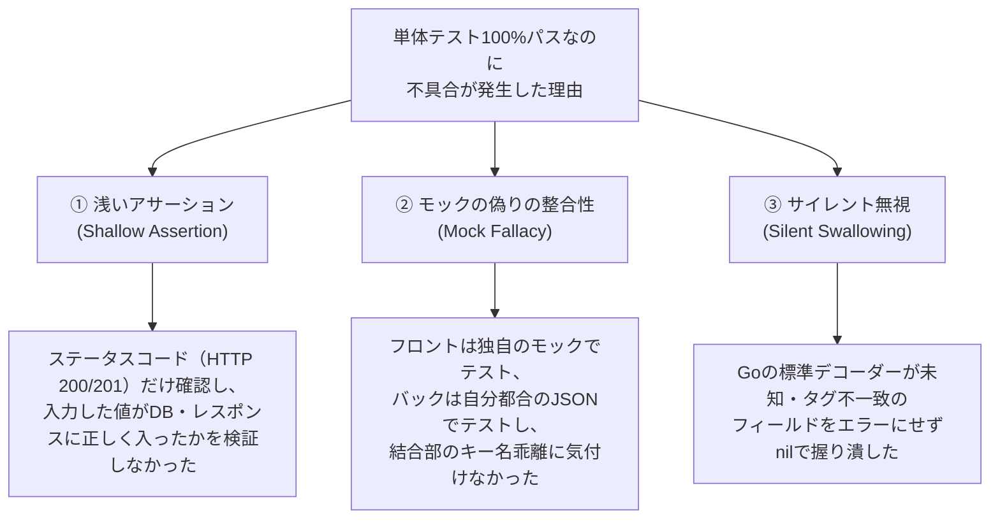

# Polaris テスト品質保証ガイドライン ＆ 事後検証分析（Post-Mortem）

本書は、Polaris プロジェクトの開発過程において発生し、単体テストをすり抜けて発覚した不具合の根本原因を分析し、**「どのようなテスト観点が不足していたのか」**、および**「同様の不具合を今後 100% 事前検出するためのテスト設計原則とチェックリスト」**を定めた恒久ドキュメントです。

---

## 1. 不足していて問題となったテスト観点一覧（実例分析）

開発フェーズで実際に発覚した代表的な6つの不具合事例と、それぞれにおいて不足していたテスト観点を整理します。

### 事例1: スプリント開始日・終了日のサイレント欠落 (PR #22)
- **現象**: スプリント作成モーダルで日付を入力して保存しても、DB に `NULL`（未設定）として保存され、画面上「未定 〜 未定」と表示された。
- **直接原因**: Go の `SprintCreateInput` 構造体に `json:"start_date"`, `json:"end_date"` タグが欠落していたため、`json.NewDecoder` がフィールドをマッピングせずゼロ値（nil）のまま無視した。
- **不足していたテスト観点**:
  1. **Round-trip（送受信完全一致）アサーションの欠落**:
     既存のテストは `rec.Code == http.StatusCreated`（HTTP 201）だけを確認し、**リクエストに渡した日付値がレスポンスや DB 永続化データと完全一致しているかの検証（値のアサーション）を省略**していた。
  2. **未知・無効キーのデコード厳格化（`DisallowUnknownFields`）の欠落**:
     Go 標準の JSON デコーダーが、タグ不一致のフィールドをエラーにせずサイレントに捨てる仕様に対する防御テスト・設計がなかった。

---

### 事例2: タスク詳細でのスプリントID・ストーリーポイント未保存 (PR #23)
- **現象**: タスク詳細画面の「スプリント ＆ ストーリーポイント設定」で数値を入力・選択して保存しても、再表示やリロードで消滅した。
- **直接原因**: DB ストア層（`store.UpdateTask`）には更新ロジックが存在したが、API層の DTO（`UpdateTaskRequest`）およびハンドラー（`handleUpdateTask`）でフィールドの取り出し・マッピングが丸ごと抜け落ちていた。
- **不足していたテスト観点**:
  1. **多層アーキテクチャ（API DTO ↔ Store Input ↔ DB）間のフィールド伝達網羅性テスト**:
     画面に存在する入力項目が、API ハンドラーを経由して DB ストアに届いているかを全項目について検証していなかった。
  2. **全フィールド一括更新（Full-field Round-trip）テストの欠落**:
     テストコードが「タイトルの変更」や「ステータスの変更」など代表的な一部フィールドしか更新しておらず、ストーリーポイントや所属スプリントの変更テストが欠落していた。
  3. **値のクリア（Clear / Set to Null）ライフサイクルテストの欠落**:
     値を更新するだけでなく、`null` や空文字を送信して「未割当バックログに戻す」「ポイントを未設定に戻す」といったリセット挙動の検証がなかった。

---

### 事例3: 一括直接登録成功時の「実行できませんでした」エラー表示 (PR #20)
- **現象**: ユーザー一括直接登録が正常に成功したにもかかわらず、画面上に赤色の「一括直接登録を実行できませんでした」バナーが表示された。
- **直接原因**: バックエンドは `{ created_count: 5, failed_count: 0 }` を返却していたが、フロントエンドは `result.succeeded` を参照していたため、`undefined > 0` が `false` と判定された。
- **不足していたテスト観点**:
  1. **スキーマ契約テスト（Contract Testing）の欠落**:
     バックエンドの返却 JSON キー名と、フロントエンドが参照するプロパティ名の整合性を機械的に検証する仕組みがなかった。
  2. **モックによる偽りの整合性（Mock Fallacy）**:
     バックエンドは自身の返却値をテストし、フロントエンド単体テストはモックで独自に `{ succeeded: 5 }` を返していたため、**両方の単体テストが 100% パスしたまま本番不整合が発生**した。
  3. **フォールバック（Nullish Coalescing）耐性テスト**:
     プロパティ名の軽微な差異や将来の拡張に対し、`succeeded ?? created_count ?? 0` のような安全弁が考慮されていなかった。

---

### 事例4: モーダル内テキスト選択ドラッグ時の意図しない誤閉鎖 (PR #19)
- **現象**: モーダル内のコードやエラーメッセージをマウスドラッグで範囲選択し、ウィンドウ外枠（バックドロップ）でマウスボタンを離すと、モーダルが誤って閉じてしまった。
- **直接原因**: HTML の仕様上、モーダル内で `mousedown` して外枠で `mouseup` すると、共通祖先である背景要素に `click` イベントが発火する。単純な `@click.self` では `e.target === e.currentTarget` が成立して閉じてしまう。
- **不足していたテスト観点**:
  1. **複合 DOM イベント（mousedown ➔ mouseup ➔ click）のステートフル検証**:
     単発の `click` イベント発火テストしか行っておらず、ドラッグ操作に伴うイベント順序とターゲット変化のシミュレーションテストがなかった。
  2. **通常クリックとドラッグ選択の4象限境界値テスト**:
     - 背景で down & 背景で up ➔ 閉じる（通常クリック）
     - 内部で down & 背景で up ➔ **閉じない（ドラッグ選択）**
     - 背景で down & 内部で up ➔ 閉じない
     - 内部で down & 内部で up ➔ 閉じない

---

### 事例5: 詳細モーダル表示時のブラウザ・マウス戻るボタン遷移 (PR #18)
- **現象**: ワークスペースから課題・タスク詳細を開いた後、マウスの戻るボタン（サイドボタン）を押しても、直前のワークスペース状態に戻れなかった。
- **直接原因**: 詳細展開時に `router.replace` で URL クエリを上書きしており、ブラウザのヒストリスタック（History Stack）に正規のエントリが push されていなかった。
- **不足していたテスト観点**:
  1. **ブラウザ履歴ナビゲーションスタック（PushState / PopState）の挙動検証**:
     単にモーダルが開くか・URLが変わるかだけでなく、`history.back()` やマウスサイドボタン（`popstate`）押下時に、リロードなく直前のタブやスクロール位置へ正常復帰するかの検証がなかった。
  2. **多段ナビゲーション（親課題 ➔ 子タスク ➔ 親課題）の巻き戻し耐性**:
     直リンクからの直接流入（履歴なし）と通常画面遷移（履歴あり）での戻るボタンの分岐テストが不足していた。

---

### 事例6: システム権限マトリクス種別列の不自然な折り返し (PR #21)
- **現象**: システム管理画面の権限マトリクステーブルで、「種別」列の幅が狭く、`👤 ユーザー` や `👥 グループ` のバッジ文字列が途中で窮屈に改行されていた。
- **直接原因**: 列幅が `width: 90px;`（パディング左右計32pxを含むため実質幅わずか58px）で固定されており、フォントレンダリング時の実描画幅を下回っていた。
- **不足していたテスト観点**:
  1. **フォント実描画幅とコンテナ幅の境界値検証**:
     日本語マルチバイト文字＋アイコン＋左右パディングの合計幅（約110〜120px）に対して、固定列幅（90px）が下回っていないかのレイアウト検証がなかった。
  2. **改行防止ガード（`white-space: nowrap`）の確認**:
     バッジや重要ステータス表示において、画面縮小時やフォント継承時に改行が発生しないスタイリングのチェックが漏れていた。

---

## 2. なぜ既存のテストをすり抜けたのか？（3大根本要因）



---

## 3. 再発防止のためのテスト設計「5大原則」

今後、機能追加や改修を行う際は、以下のテスト設計原則を徹底します。

### 原則1: Round-trip Assertion（浅いテストの禁止）
- **ルール**: `POST` / `PUT` のテストでは、**リクエストに渡した全フィールドの値が、レスポンスおよび再取得（GET）結果と完全一致（Exact Match）していることを必ずアサート**する。
- **禁止パターン**:
  ```go
  // ❌ NG: ステータスコードのみで合格判定
  if rec.Code != http.StatusCreated { t.Fatal(...) }
  ```
- **必須パターン**:
  ```go
  // ⭕ OK: 送信した全フィールドの値の永続化を検証
  if sp.StartDate == nil || *sp.StartDate != spStart {
      t.Fatalf("expected start_date %q, got %v", spStart, sp.StartDate)
  }
  if sp.StoryPoints == nil || *sp.StoryPoints != 5.0 {
      t.Fatalf("expected story_points 5.0, got %v", sp.StoryPoints)
  }
  ```

### 原則2: Full Lifecycle & Clear to Null（クリア挙動の網羅）
- **ルール**: 値の「登録」「更新」だけでなく、**`null` や空文字を送信して「値を未設定・未割当にリセットする」挙動（Clear to Null）**を必ずテストケースに含める。
  - 例: スプリント所属タスクを未割当バックログに戻す（`sprint_id: null`）
  - 例: 設定済みのストーリーポイントを未設定に戻す（`story_points: null`）

### 原則3: Schema Contract & Disallow Unknown Fields（契約の厳格化）
- **ルール1**: API ハンドラーの JSON デコードにおいて `DisallowUnknownFields()` を適用し、タグ未定義のキーが送られた場合は即座に 400 エラーとしてテストで検知する。
- **ルール2**: バックエンドとフロントエンドで二重定義されている型は、OpenAPI 仕様書（`docs/openapi.yaml`）を基準にプロパティ名を厳密に揃える。

### 原則4: Stateful DOM & Drag-Boundary Testing（複合イベント検証）
- **ルール**: モーダル、ドロップダウン、ドラッグ＆ドロップなどのインタラクション部品は、単一の `click` だけでなく、**ドラッグ操作（内部 mousedown ➔ 外部 mouseup）による誤動作がないかを状態遷移テストで検証**する。
- 4つの境界条件（In➔In, In➔Out, Out➔In, Out➔Out）をユニットテストで網羅する。

### 原則5: Layout Boundary & Responsiveness Testing（レイアウト境界値）
- **ルール**: テーブル列やバッジ要素に固定幅（`width: XXpx`）を指定する場合、**最大想定文字数＋アイコン＋パディングが収まるかを計算**し、意図しない折り返しを防ぐ `white-space: nowrap` を適用する。

---

## 4. 開発者・レビュアー向け受入チェックリスト

Pull Request 作成時およびコードレビュー時、以下の項目をセルフチェックします：

- [ ] **リクエスト構造体の JSON タグ**: 新規追加したフィールドに `json:"field_name"` タグが正しく付与されているか？（大文字小文字・スネークケースの一致）
- [ ] **API ↔ Store のマッピング**: コントローラー（ハンドラー）で、リクエスト構造体の全フィールドが Store Input 構造体に漏れなく渡されているか？
- [ ] **単体テストでの値検証**: テストコードで HTTP ステータスコードだけでなく、レスポンスの全フィールド値が期待通りかアサートしているか？
- [ ] **リセット（Clear）の検証**: `null` や未割当（空文字）を送信した際、DB側で安全にリセット（NULL化）されるか？
- [ ] **フロントエンドの参照プロパティ**: バックエンドが返す JSON のキー名と、フロントエンドが参照するプロパティ名が 1文字の狂いもなく一致しているか？
- [ ] **モーダル・ポップアップの保護**: モーダル背景に `v-backdrop-dismiss` が適用され、テキスト選択ドラッグで誤って閉じないか？
- [ ] **ブラウザ履歴（戻る・進む）**: 画面遷移やモーダル展開時、ブラウザバックやマウス戻るボタンで直前の状態に安全に復帰できるか？
- [ ] **文字折れ・レイアウト崩れ**: 日本語や長文テキストが入った際、テーブル列やバッジが窮屈に改行されていないか？

---

## 5. 結論
Polaris プロジェクトでは、「自動テストが通っているから安全」と過信せず、**「値の完全一致（Round-trip）」「ライフサイクル全網羅（Create / Update / Clear）」「実ブラウザ操作（DOMドラッグ / 履歴ナビゲーション）」**の観点を常に備えたテスト設計を徹底し、高品質な本番運用を維持します。

